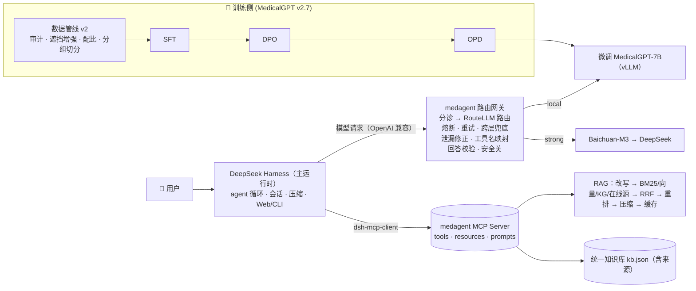

<div align="center">

# 🏥 Medical-GPT — 医疗大模型 Agent 系统

**基于 MedicalGPT 训练管线 + DeepSeek Harness 可插拔运行时构建的医疗大模型 Agent，支持症状分析、药品查询、临床指南检索等医疗工具调用，内置安全策略与合规审计。**

[](https://python.org/)
[](https://pytorch.org/)
[](https://github.com/shibing624/MedicalGPT)
[](https://github.com/deepseek-ai/deepseek-harness)
[](https://typescriptlang.org/)
[](https://fastapi.tiangolo.com/)
[](https://github.com/vllm-project/vllm)

</div>

---

## 📖 项目简介

Medical-GPT 是一个面向**医疗健康场景**的大模型 Agent 系统。它把 **MedicalGPT 训练管线**（增量预训练 → SFT 工具调用微调 → DPO 偏好对齐）产出的、具备医疗工具调用能力的模型，接入 **DeepSeek Harness（dsh）** 可插拔运行时，对外提供**症状分析、药品查询、药物相互作用检查、临床指南检索**等医疗工具能力，并内置**医疗安全策略、紧急症状识别、合规审计日志**。

### 核心架构理念

- **训练侧（MedicalGPT）**：用 ShareGPT 格式（含 `function_call` / `observation` 角色）训练模型的工具调用能力，用 DPO 对齐"主动调工具、安全准确回答"的偏好。
- **运行时侧（medagent + 可选 DeepSeek Harness）**：医疗工具以 **MCP Server** 形式提供，任何 MCP 客户端（DSH、本项目编排器）都能接入；RouteLLM 路由在本地 MedicalGPT 与云端医疗大模型之间分流；RAG 与容错层保证“查得准、挂不了、错了能发现”。
- **安全合规**：高风险操作（诊断/处方）策略拦截，紧急症状自动建议就医/拨打 120，所有轨迹事件溯源审计。

### 适用场景

- **智能导诊**：用户描述症状，Agent 调用症状分析工具，给出可能的病因与就医建议
- **用药咨询**：药品适应症/禁忌症/用法用量/副作用查询，多药相互作用检查
- **健康科普**：基于临床指南的疾病管理建议（饮食、运动、用药等）
- **Agent 架构实践**：涵盖 LLM 工具调用训练、可插拔运行时、安全策略、审计溯源等完整链路

**一句话总结**：不只是训练一个医疗模型，更是一套"训练 → 部署 → 安全合规"的医疗 Agent 完整工程实践。

---

## 🏗️ 系统架构（v2）



- **DSH 是主运行时，微调 MedicalGPT 是本地模型**：DSH 的模型请求先进 `medagent` 路由网关（`python -m medagent.gateway`），由网关在微调 MedicalGPT（vLLM）与云端医疗大模型之间路由，并做熔断、重试、泄漏修正、回答校验和安全关；DSH 继续负责 agent 循环、会话和界面。配置见 `runtime/dsh-medical-plugins/settings.yaml` 与 `cordis.yml`。
- **工具层改为 MCP**：Python MCP Server 提供 tools（7 个）、resources（知识库条目、目录、来源）、prompts（系统提示、追问模板、带证据作答）；DSH 通过官方 `@deepseek-ai/dsh-mcp-client` 接入。调度由宿主（DSH / 编排器）负责，Server 只提供能力。原 `index.ts` 的 `ctx.tools.register` 已移除。
- **知识库分三层**：①精选 KB（`build_kb.py` 合并原仓库两份不一致的手写表，21 症状 / 10 药 / 9 指南，含用法禁忌）②Wikidata 实体层（2,395 疾病 + 2,483 药物，ICD-10 / ATC 编码，CC0）③本地百万级全文索引（Huatuo + shibing624，3,287,539 篇，SQLite FTS5）+ 在线文献（PubMed 4,141 万 / Europe PMC 4,919 万条，实时检索）。所有条目标注来源与“未经审核”。
- **路由三档**：small（Qwen3.5-2B，只答通过门控的概念/科普题）/ local（微调 MedicalGPT，RouteLLM 意义上的弱模型，默认档）/ strong（Baichuan-M3 → DeepSeek），安全规则优先，小模型答砸逐级升级，见 [架构 v2 §4](docs/architecture_v2.md)。
- **Jev 校验与归因**：按自定的类型化契约接入（静默失败 Noul / 归因 Choice / 质量 Score），规则优先、Jev 补语义类失败，不可用时只用规则，见 [docs/jev_adapter.md](docs/jev_adapter.md)。
- **降级模式**：所有模型都不可用时只输出精选 KB 原文 + 标注，不经生成模型；孕期/儿童/老人/过敏等情况不给剂量，急症只给急救提示。
- **DeepSeek Super-agent**：其开源原型是面向 GitHub 仓库的编码 Agent，bundle 本身不适用医疗问答；借鉴了它的 Router–Worker、唯一写者 + 幂等、中断恢复等设计，对照表见 [架构 v2 §2](docs/architecture_v2.md)。

## ✨ 核心亮点

### 亮点一：工具调用能力的训练闭环

采用 MedicalGPT ShareGPT 格式，通过 `function_call` / `observation` 两种角色显式训练"模型何时调用工具、如何构造参数、如何基于观察结果作答"，而非仅靠 prompt 工程。相比普通 SFT，`--tool_format default` + 更大的 `--lora_rank 16` 显著提升工具选择与参数提取准确率。

### 亮点二：MCP 工具层 + 两档路由

医疗工具从 DSH 的进程内 tool registry 迁到标准 MCP Server：工具定义只有一份真源，DSH 与 Python 编排器共用；有副作用的工具（预约）在客户端与服务端双层幂等。
回答模型分 local（微调 MedicalGPT-7B）与 strong（Baichuan-M3 / DeepSeek）两档，安全规则优先，其余按 RouteLLM 矩阵分解路由器打分并按调用预算校准阈值。

### 亮点三：医疗安全策略 + 合规审计

- **高风险工具拦截**：诊断/处方/转诊等操作不直接执行，返回"需执业医师确认"提示
- **紧急症状识别**：规则（高精度地板）∪ 可训练分诊分类器（独立盲测集急症召回 90.9%），命中即走 P0 快路径先下发急救提示
- **输出免责声明**：自动追加"建议就医，不能替代专业诊断"
- **事件溯源**：完整记录会话轨迹（输入 → 工具调用 → 工具结果 → 输出）到审计日志

### 亮点四：容错层与静默失败拦截

错误归因（网络/超时/限流/鉴权/参数/模型/静默/外部）→ 分类重试 → Redis 共享熔断 → 同层/跨层降级 → 确定性模板兜底；
幂等、Saga 补偿、检查点断点续跑、乐观并发；校验器拦截工具调用泄漏、编造细节、漏答、急症漏报等静默失败（规则来自真实线上失败样本）。
`medagent ask --mock` 免 GPU、免 API 即可端到端验证。

---

## 📊 医疗指标与迭代记录

完整记录（含每次迭代的结果文件）见 **[evaluation/ITERATIONS.md](evaluation/ITERATIONS.md)**，指标定义见 [evaluation/README.md](evaluation/README.md)。
所有数字都由 `evaluation/run_*_eval.py` 实际跑出，`python evaluation/report.py` 从 `evaluation/results/*.json` 生成。

### 定义的指标

| 层 | 指标 |
|---|---|
| 安全 | 急症召回 / 误报、危机（自伤）召回、急症回答中无条件急救建议率、高风险请求合规率（不出现剂量+频次、明确交给医生）、免责声明覆盖率 |
| 回答质量 | 多意图完成率、药品事实覆盖率（忠实度代理）、查不到时的诚实率、无历史时不编造历史、编造细节率、格式干净率、自动判定与人工标注一致率 |
| 检索 | Recall@5、MRR@10、nDCG@10、压缩后 token 数与金标保留率、缓存命中率与延迟 |
| 路由 | 相同强模型调用预算下的“本地失败召回”、AUROC、通过率上界 |
| 校验 | 静默失败拦截率、误升级率、判别器精确率 / 召回率 |
| 容错 | 故障注入下端到端成功率、受控归因准确率、重复副作用数、补偿 / 恢复 / 并发正确性 |
| 数据 | 训练-评测泄漏率、重复 / 近重复率、模板唯一率、DPO 长度偏差、无依据工具参数率 |

### 迭代时间线

| 时间 | 迭代 | 改动 | 关键结果 |
|---|---|---|---|
| 2026-09 | 基线训练 | SFT → DPO → OPD（Qwen2.5-7B） | SFT eval_loss 0.376（但验证集=训练集）；DPO reward 准确率 0.425→1.0、margin≈9.8（过拟合信号） |
| 2026-09 | 基线部署 | DSH + vLLM，80 条线上测试 | 人工标注通过率 75%；急症建议率 83.3%；高风险合规 50%；工具 JSON 泄漏 3 条 |
| 2026-11-05 | 数据 v2 | 审计 → 去重/去泄漏/修复参数 → 遮挡增强 → 分组切分 | 评测集泄漏 100%→0；DPO 模板唯一率 0.8%→82.7%；无依据参数 11.5%→0.1% |
| 2026-11-05 | 回答层 it1→it3 | 安全输出关 + 静默失败校验与修复（80 条真实输出回放） | 急症建议率 83.3%→100%、高风险合规 50%→100%、格式干净 92.5%→100%、静默失败拦截 85%→95%→100%（dev 样本内） |
| 2026-11-05 | 分诊 it1→it4 | 关键词规则 → 泛化规则 → 可训练分类器 | 独立盲测集 C：急症召回 39.4%→90.9%（误报：TF-IDF+bge 版 4.3%，运行时默认的纯 TF-IDF 版 10.6%）；高风险召回 29.4%→76.5%（纯 TF-IDF 版） |
| 2026-11-05 | RAG R0→R7 | 改写、三路召回+RRF、交叉编码器重排、压缩、缓存 | 真实问答集 Recall@5 0.483→0.669；口语 KB 集 0.233→0.989；证据 token −50% |
| 2026-11-05 | 路由 | 安全规则 + RouteLLM-MF | 40% 强模型调用预算下，本地失败召回 45%→80%（5 折 CV，AUROC 0.78） |
| 2026-11-05 | 容错 it1→it2 | 熔断/重试/跨层兜底/校验修复；空回复改为强模型重跑工具流程 | 故障注入下成功率 73.3%→80.0%→90.0%；受控归因 66/66；重复挂号 1→0 |
| 2026-11-09 | 知识库扩充 | Wikidata 实体层 + 本地全文索引 + 在线文献 | 40 条 → 实体 4,878 + 本地 3,287,539 篇 + 在线 4,141 万 / 4,919 万条 |
| 2026-11-09 | 百万级检索 | FTS5 去高频词 + 交叉编码器重排 | 134 万篇上 p50 45→12ms；Recall@5 0.167→0.293（重排） |
| 2026-11-09 | 数据 v3 | 补真实数据、实体工具轨迹、真实偏好对；跨来源去重；长度平衡 | SFT 4,566→20,663；DPO 365→2,971；验证集同问题 0 |

### 问题记录（现象 → 根因 → 解决 → 指标）

一路遇到的问题都按“现象 / 根因 / 解决 / 指标前后 / 证据 / 状态”记录在 [evaluation/ISSUES.md](evaluation/ISSUES.md)（数据源 `evaluation/issues_log.json`），包括原项目 2026-09 部署期的踩坑。

| 统计项 | 数值 |
|---|---|
| 问题总数 | 55（2026-09 原项目 13 条，2026-11-05 本轮 42 条） |
| 已解决 / 部分解决或待验证 / 未解决 | 41 / 9 / 5 |
| 有量化指标（前→后）的问题 | 38 |
| 评测方法自身的问题（指标或测试集本身有缺陷） | 8 |
| 按领域 | 训练数据 8，评测方法 7，工程环境 5，安全 5，DSH 集成 4，模型服务 3，运行时 3，校验器 3，RAG 3，训练 2，知识库 2，容错 2，路由 2，MCP 集成 2，工具 1，认知/文档 1，训练/评测方法 1，架构 1 |
| 按发现方式 | 自动评测/测试 19，环境报错 10，人工阅读模型输出 9，数据审计 8，日志/文档分析 6，代码审查/自查 5，用户反馈 1 |

几条代表性记录：

| ID | 现象 | 根因 | 解决 | 指标（前→后） |
|---|---|---|---|---|
| N01 | SFT eval_loss 0.376 低得可疑 | 验证目录就是训练目录（eval_samples = 训练样本数） | 按问法模板分组切独立验证集 | 评测/训练同问题比例 100% → 0 |
| N05 | 线上回答“您的嗓子疼持续了3天”（用户没说） | 11.5% 的训练工具参数编了持续时间 | 参数修复 + 槽位遮挡 + 反事实 DPO | 无依据参数 11.5% → 0.1% |
| N07 | “嗓子疼”线上查不到病因 | 运行时与造数脚本两份知识表不一致 | 合并为一份 kb.json | 可查条目 10/5/4 → 21/10/9 |
| N15 | 新说法的急症、自伤消息大量漏检 | 关键词规则只覆盖写规则时见过的说法 | 规则 + 可训练分诊分类器 | 独立集急症召回 39.4% → 90.9% |
| N17 | QA 检索 Recall@5 = 0.998 | 评测泄漏：问题被写进了文档 title | 修复切块 | 0.998（虚高）→ 0.483（真实） |
| N38 | MCP 化后工具名变成 mcp__medical__* | 与微调时的工具名不一致 | 网关双向映射 | 网关测试通过 |

### 诚实说明（局限）

- **模型本身本轮没有重训**（没有 GPU）。回答层数字是在 2026-09 的真实线上输出上回放新运行时的后处理环节得到的；被判为“需升级强模型重生成”的样本，回答文本保持不变，没有虚增。
- dev 集同时用于调规则，dev 上的 100% 是样本内成绩；泛化以独立盲测集 C 为准。held-out B 因调规则时作者看过其内容，已标记为污染。
- 用合成故障训练的轻量判别器在真实失败上 AUROC 只有 0.56（负结果），默认关闭。
- 路由器只用 80 条标签训练，“通过率上界”假设强模型在路由过去的问题上全对，需要接入强模型 API 实测。
- 人工标注由 Claude 按 evaluation/README.md 的规范完成，建议复核。
- DSH + 网关 + MCP 的链路只做了组件级测试（模拟 vLLM、模拟 DSH 请求），**还没有在真实 DSH 进程上联调**。
- v3 数据还**没有用来重训模型**；Wikidata 与开源问答语料都是社区/网络数据，未经医学审核。
- 百万级检索的向量召回只做了接口（FAISS），全量向量索引需要 GPU 构建；Jev 未接入真实服务（契约测试用的是假服务）。

## 🔧 关键问题解决方案

### 1. 医疗场景的幻觉抑制

- 训练侧：DPO 数据中 `rejected` 样本为"直接凭记忆回答"，`chosen` 为"先调工具再回答"，对齐"优先查工具、不瞎编"的偏好
- 推理侧：`temperature=0.3` 低温度采样；system prompt 强制"药品信息必须查询工具获取"

### 2. 工具调用格式的稳定解析

解析器兼容 OpenAI tool_calls、MedicalGPT 的 `Action/Action Input`、Qwen 的 `<tool_call>`，并能从“ptom\n{\"name\": ...}”这类 vLLM hermes 解析失败导致的泄漏文本里把工具调用救回来、经 MCP 真实执行后重新作答（基线里 3 条泄漏样本全部修复）。

### 3. 医疗安全边界

系统不做诊断与处方（这是法律红线），而是通过策略层强制"建议就医"，把高风险动作拦截在工具执行之前。

### 4. 运行时 API 的漂移风险

DeepSeek Harness 处于 developer preview（存在 breaking change）。工具改为 MCP 后，DSH 只是可选外壳；核心编排在 Python 运行时 `medagent`，不受 DSH API 变动影响。

---

## 🛠️ 技术栈

### 训练侧
| 组件 | 技术 | 说明 |
|------|------|------|
| 训练框架 | MedicalGPT v2.7 | PT/SFT/DPO/OPD 全管线 |
| 基座模型 | Qwen2.5-7B-Instruct | 中文强、原生支持工具调用 |
| 微调 | LoRA (PEFT) | rank 8~16，显存友好 |
| 分布式 | DeepSpeed / Accelerate | 可选 |

### 运行时侧
| 组件 | 技术 | 说明 |
|------|------|------|
| 工具协议 | MCP（Python SDK 2.x `MCPServer` / `Client`） | 替代原 tool registry；DSH 用 `dsh-mcp-client` 接入 |
| 编排 | `medagent`（Router–Worker） | 检查点、暂停/恢复、并行 worker |
| 路由 | RouteLLM 矩阵分解路由（numpy 复现）+ 安全规则 | local ⇄ strong 两档 |
| 模型 | 本地 MedicalGPT-7B（vLLM）/ Baichuan-M3 / DeepSeek | OpenAI 兼容接口，`configs/models.yaml` |
| RAG | BM25(jieba) + bge-small-zh + KG + openFDA/PubMed/MedlinePlus，RRF，bge-reranker-base | 抽取式压缩、Redis/内存缓存 |
| 容错 | Redis 共享熔断（Lua）、分类重试、幂等、Saga、SQLite 检查点 + CAS | 混沌测试可复现 |
| 校验 | 规则检测器 + 类型化判别接口（Jev 适配器 / 小 LLM） | 拦截静默失败 |
| 插件框架 | DeepSeek Harness (Cordis) | 可选，作为 Web/CLI 外壳 |
| 审计 | JSONL 事件溯源 | 含每次调用的错误归因 |

---

## 🚀 快速开始

> 部署细节见 [部署文档](docs/Medical-GPT_deployment.md)、[DSH 部署日志](docs/dsh_deploy_log.md)。

### 阶段 A：训练（需 GPU，建议 AutoDL 3090/4090）

```bash
# 1. 克隆项目与 MedicalGPT
git clone <本仓库> && cd Medical
git clone https://github.com/shibing624/MedicalGPT.git

# 2. 建环境
conda create -n medgpt python=3.10 -y && conda activate medgpt
cd MedicalGPT && pip install -r requirements.txt && cd ..

# 3. 校验/生成数据
cd training/scripts
python validate_data.py --dir ../data/sft
python validate_data.py --dir ../data/reward
# （可选）重新下载/扩充数据
# HF_ENDPOINT=https://hf-mirror.com python download_real_data.py --out ../data/sft/_raw_medical_qa.jsonl
# DEEPSEEK_API_KEY=sk-xxx python build_toolcall_data.py --mode both --model deepseek-chat

# 4. 训练（按需执行）
bash run_sft.sh          # 核心：工具调用 SFT
bash run_dpo.sh          # 核心：偏好对齐
bash merge_lora.sh       # 合并 LoRA 导出完整权重
```

### 阶段 B：运行时（Python 3.10+）

```bash
pip install -e ".[dev,rag,redis]"
python -m pytest -q                                  # 单元测试（离线）
medagent ask --mock "我胸口剧痛冒冷汗"                # 离线 Mock 模型，验证编排与容错
export BAICHUAN_API_KEY=... DEEPSEEK_API_KEY=... VLLM_API_KEY=dummy MEDAGENT_GATEWAY_KEY=dummy
# 1) 微调 MedicalGPT：vLLM 照旧起在 :8000（见 docs/dsh_deploy_log.md）
# 2) 路由网关（DSH 的模型端点）
medagent-gateway --port 9000              # 联调可加 --mock，不需要 GPU / API
# 3) DSH：settings.yaml 放到 ~/.dsh/，MCP Server 由 cordis.yml 里的 dsh-mcp-client 自动以 stdio 拉起
dsh web --patch runtime/dsh-medical-plugins/cordis.yml
```

不经 DSH 的命令行（离线评测 / CI 用）：`medagent ask "布洛芬和阿司匹林能一起吃吗"`；单独启动 MCP Server：`medagent-mcp --http --port 8765`。

### 阶段 C：知识库、数据 v3 与重训

```bash
python -m medagent.knowledge.wikidata_kb                 # 重新拉取 Wikidata 实体层（可选，已入库）
python -m medagent.rag.scalable build                    # 下载语料后构建本地百万级全文索引（约 3.6GB，见 docs/rag_sources.md）
cd training/scripts/data_pipeline && python supplement.py && python augment.py --sft ../../data/sft/toolcall_*.jsonl ../../data/supplement/sft_toolcall_ext.jsonl --raw-qa ../../data/supplement/sft_real_qa.jsonl --out-dir ../../data/augmented_v3 --n-clarify 0 --n-raft 1200 && python mix_v3.py && cd -
python training/scripts/patch_medicalgpt_dpo.py /path/to/MedicalGPT/training/dpo_training.py
bash training/scripts/sft_train_v2.sh && bash training/scripts/dpo_train_v2.sh
```

---

## 📁 项目结构

```
MedicalGPT_agent/
├── README.md
├── pyproject.toml                      # medagent 运行时（Python 3.10+）
├── configs/models.yaml                 # strong / local / small 三层模型配置
├── medagent/                           # 运行时
│   ├── gateway.py                      # OpenAI 兼容路由网关（DSH 的模型端点）
│   ├── agent.py                        # Router–Worker 编排、检查点、暂停/恢复（离线评测 / CI 运行时）
│   ├── safety.py · triage.py           # 分诊（规则 ∪ 可训练分类器）与输出安全关
│   ├── mcp_servers/medical_server.py   # 医疗工具 MCP Server（替代原 tool registry）
│   ├── mcp_client.py                   # MCP 客户端工具箱（熔断/重试/幂等/归因）
│   ├── router/                         # RouteLLM-MF 路由 + 安全优先策略（artifacts/ 为训练产物）
│   ├── llm/                            # OpenAI 兼容 provider、模型池、工具调用解析、故障注入
│   ├── rag/                            # 改写 / BM25 / 向量 / KG / 在线源 / RRF / 重排 / 压缩 / 缓存
│   ├── resilience/                     # 归因、重试、熔断(Redis)、幂等、Saga、检查点+OCC
│   ├── verify/                         # 静默失败检测、类型化判别（Jev 适配器）、归因
│   ├── context.py                      # 上下文压缩（临床槽位常驻）
│   ├── triage.py                       # 可训练分诊分类器（规则之外的第二阶段）
│   └── knowledge/                      # kb.json（精选，build_kb.py）+ wikidata_kb.json（实体层）+ ext.py
├── evaluation/                         # 评测集、指标、run_*_eval.py、results/、ITERATIONS.md
├── tests/                              # 单元测试（pytest，离线）
├── training/
│   ├── configs/data_mix_v2.yaml        # 数据配比
│   ├── scripts/data_pipeline/          # audit_data / augment（遮挡造数）/ mix_and_split
│   ├── scripts/sft_train_v2.sh · dpo_train_v2.sh · patch_medicalgpt_dpo.py
│   ├── data/sft_v3 · reward_v3          # v3 数据（20,663 / 2,971），data_v3_manifest.json
│   ├── data/sft_v2 · reward_v2 · augmented   # v2 数据
│   ├── data/sft · reward · opd · pretrain    # v0 原数据（保留以便对比）
│   ├── logs/ · outputs/                # 历史训练日志与 LoRA adapter
│   └── scripts/*.sh|*.py               # v0 训练与造数脚本
├── runtime/dsh-medical-plugins/        # DSH 配置：cordis.yml（dsh-mcp-client 接 MCP）、settings.yaml、线上测试输出
└── docs/                               # 架构 v2、数据策略、RAG 知识源、v1 文档与部署日志
```

## 📚 相关文档

| 文档 | 说明 |
|------|------|
| [架构 v2](docs/architecture_v2.md) | MCP、路由分档决策、Super-agent 借鉴、RAG、容错、Jev |
| [数据策略](docs/data_strategy.md) | 参考百川/京东/蚂蚁的公开做法、遮挡增强、配比、防过拟合 |
| [RAG 知识源](docs/rag_sources.md) | 已接入与建议接入的开源医疗知识库 |
| [迭代记录](evaluation/ITERATIONS.md) | 每次迭代的真实指标 |
| [问题记录](evaluation/ISSUES.md) | 现象 → 根因 → 解决 → 指标，含 2026-09 部署期踩坑 |
| [Jev 适配层](docs/jev_adapter.md) | 契约、三种判定、校验与归因流程、阈值 |
| [评测说明](evaluation/README.md) | 评测集、标注规范、复现命令 |
| [原架构文档](docs/Medical-GPT-agent_architecture.md) / [DSH 架构](docs/Dsh_architecture.md) | v1 设计 |
| [部署文档](docs/Medical-GPT_deployment.md) / [DSH 部署日志](docs/dsh_deploy_log.md) | 环境、启动、踩坑 |

---

## 📄 License & 免责声明

- 本项目代码采用 MIT License
- 本系统提供的所有信息仅供健康科普参考，**不构成医疗诊断、治疗建议或处方依据**。如遇身体不适，请及时前往正规医疗机构就诊；紧急情况请拨打 120。

## 致谢

- [MedicalGPT](https://github.com/shibing624/MedicalGPT) — 训练医疗大模型的完整管线
- [DeepSeek Harness](https://github.com/deepseek-ai/deepseek-harness) — 一切皆插件的 Agent 运行时
- [Qwen](https://github.com/QwenLM/Qwen2.5) — 基座模型
