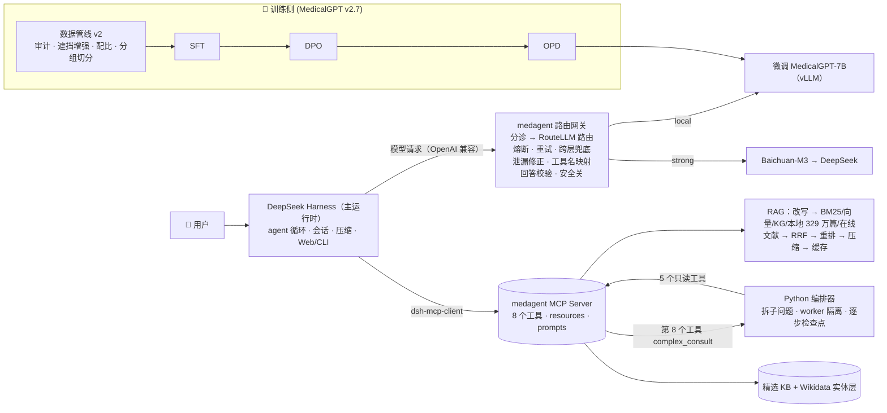

<div align="center">

# 🏥 Medical-GPT — 医疗大模型 Agent 系统

**基于 MedicalGPT 训练管线 + DeepSeek Harness 可插拔运行时构建的医疗大模型 Agent，支持症状分析、药品查询、临床指南检索等医疗工具调用，内置安全策略与合规审计。**

[](https://python.org/)
[](https://pytorch.org/)
[](https://github.com/shibing624/MedicalGPT)
[](https://github.com/deepseek-ai/deepseek-harness)
[](https://typescriptlang.org/)
[](https://fastapi.tiangolo.com/)
[](https://github.com/vllm-project/vllm)

</div>

---

## 📖 项目简介

Medical-GPT 是一个面向**医疗健康场景**的大模型 Agent 系统。它把 **MedicalGPT 训练管线**（增量预训练 → SFT 工具调用微调 → DPO 偏好对齐）产出的、具备医疗工具调用能力的模型，接入 **DeepSeek Harness（dsh）** 可插拔运行时，对外提供**症状分析、药品查询、药物相互作用检查、临床指南检索**等医疗工具能力，并内置**医疗安全策略、紧急症状识别、合规审计日志**。

### 核心架构理念

- **训练侧（MedicalGPT）**：训练数据统一为 **OpenAI 格式**（messages + tools + tool_calls，与线上请求同构），由 `export_formats.py` 生成 MedicalGPT 的输入；SFT 学工具调用，DPO 对齐"主动调工具、安全准确回答"的偏好，OPD 用 Qwen3.5-27B 教师在线蒸馏提升问答质量。
- **运行时侧（DeepSeek Harness + medagent）**：DSH 负责 agent 循环、会话与界面；medagent 路由网关在小模型、微调 MedicalGPT、云端医疗大模型三档之间分流，并做熔断、重试、跨层兜底、回答校验和输出安全关；医疗工具与知识资源以 **MCP Server** 形式接入，“复杂问诊”编排器在网关内按需运行；RAG 连接本地 329 万篇全文索引与 PubMed / Europe PMC 等在线文献。
- **安全合规**：高风险操作（诊断/处方）策略拦截，紧急症状自动建议就医/拨打 120，所有轨迹事件溯源审计。

### 适用场景

- **智能导诊**：用户描述症状，Agent 调用症状分析工具，给出可能的病因与就医建议
- **用药咨询**：药品适应症/禁忌症/用法用量/副作用查询，多药相互作用检查
- **健康科普**：基于临床指南的疾病管理建议（饮食、运动、用药等）
- **Agent 架构实践**：涵盖 LLM 工具调用训练、可插拔运行时、安全策略、审计溯源等完整链路

**一句话总结**：不只是训练一个医疗模型，更是一套"训练 → 部署 → 安全合规"的医疗 Agent 完整工程实践。

---

## 🏗️ 系统架构（v2）



- **DSH 是主运行时，微调 MedicalGPT 是本地模型**：DSH 的模型请求先进 `medagent` 路由网关（`python -m medagent.gateway`），由网关在微调 MedicalGPT（vLLM）与云端医疗大模型之间路由，并做熔断、重试、泄漏修正、回答校验和安全关；DSH 继续负责 agent 循环、会话和界面。配置见 `runtime/dsh-medical-plugins/settings.yaml` 与 `cordis.yml`。
- **工具层改为 MCP**：Python MCP Server 提供 tools（8 个：7 个查询 / 预约工具 + 复杂问诊 `complex_consult`）、resources（知识库条目、目录、来源、知识源状态 `kb://sources`、检索命中文档全文 `kb://doc/{id}`）、prompts（系统提示、追问模板、带证据作答）；DSH 通过官方 `@deepseek-ai/dsh-mcp-client` 接入。调度由宿主（DSH / 编排器）负责，Server 只提供能力。原 `index.ts` 的 `ctx.tools.register` 已移除。
- **复杂问诊是第 8 个 MCP 工具**：Python 编排器（Router–Worker、逐步检查点）包成医疗工具 MCP Server 的 `complex_consult`，和另外 7 个工具一样由模型决定调用、由 DSH 执行。多意图问题先由路由器选档，再由被选中的模型决定是否调用；DSH 带回结果后，网关直接把编排器的回答交给用户，不再让模型转述。编排器拆子问题，每个 worker 只拿子问题 + 患者槽位 + 只读工具；中断后同一请求再来即从检查点续跑，已完成的 worker 不重跑。见 [架构 v2 §2](docs/architecture_v2.md)。
- **知识库分三层**：①精选 KB（`build_kb.py` 合并原仓库两份不一致的手写表，21 症状 / 10 药 / 9 指南，含用法禁忌）②Wikidata 实体层（2,395 疾病 + 2,483 药物，ICD-10 / ATC 编码，CC0）③本地百万级全文索引（Huatuo + shibing624，3,287,539 篇，SQLite FTS5）+ 在线文献（PubMed 4,141 万 / Europe PMC 4,919 万条，实时检索）。所有条目标注来源与“未经审核”。
- **路由三档**：small（Qwen3.5-2B，只答通过门控的概念/科普题）/ local（微调 MedicalGPT，RouteLLM 意义上的弱模型，默认档）/ strong（Baichuan-M3 → DeepSeek），安全规则优先，小模型答砸逐级升级，见 [架构 v2 §4](docs/architecture_v2.md)。
- **开源判别模型校验**：Qwen3.5-2B + LoRA 微调成类型化判别器（输出质量等级 A~D 及概率，P(静默失败) = P(C)+P(D)），本机 vLLM 部署、不调外部 API；规则优先、判别模型补语义类失败，没部署时只用规则；归因仍用规则。见 [docs/verifier_model.md](docs/verifier_model.md)。
- **降级模式**：所有模型都不可用时只输出精选 KB 原文 + 标注，不经生成模型；孕期/儿童/老人/过敏等情况不给剂量，急症只给急救提示。
- **DeepSeek Super-agent**：其开源原型是面向 GitHub 仓库的编码 Agent，bundle 本身不适用医疗问答；借鉴了它的 Router–Worker、唯一写者 + 幂等、中断恢复等设计，对照表见 [架构 v2 §2](docs/architecture_v2.md)。

## ✨ 核心亮点

### 亮点一：工具调用能力的训练闭环

训练数据以 OpenAI 格式为准（`training/data/openai_v3/`）：用户消息、assistant 的 `tool_calls`、`tool` 角色的工具结果、可用工具列表 `tools`，与线上 DSH → 网关 → vLLM 的请求结构完全相同，显式训练"模型何时调用工具、如何构造参数、如何基于工具结果作答"。
MedicalGPT 读取的是 `conversations` 结构，`export_formats.py` 把 OpenAI 格式渲染成它的输入，渲染写法与上线用的 vLLM 对话模板逐字一致（有测试保证），训练学到的工具调用格式上线后能被解析器正确识别。

### 亮点二：MCP 工具层 + 三档路由

医疗工具从 DSH 的进程内 tool registry 迁到标准 MCP Server：工具定义只有一份真源，DSH 与 Python 编排器共用；有副作用的工具（预约）在客户端与服务端双层幂等。
路由是三段级联：①安全规则（急症 / 危机 / 开药诊断 → strong）②RouteLLM 矩阵分解路由器在 local（微调 MedicalGPT-7B）与 strong（Baichuan-M3 / DeepSeek）之间二选一，按调用预算校准阈值 ③判为 local 的题里，通过规则门控的概念 / 科普题交给 small（Qwen3.5-2B）。MF 的训练和评测用不同的数据：独立路由数据集（`evaluation/datasets/router_set.jsonl`，2,000 条真实问诊提问，与训练数据、所有评测集都不重叠）切成 train / val / test，train 训练、val 定阈值、test 报告；dev 80 只做人工标注的外部测试。阈值按“总体 40% 交给强模型”（含安全规则强制的部分）在真实提问上校准。

### 亮点三：医疗安全策略 + 合规审计

- **高风险工具拦截**：诊断/处方/转诊等操作不直接执行，返回"需执业医师确认"提示
- **紧急症状识别**：规则（高精度地板）∪ 可训练分诊分类器（独立盲测集急症召回 90.9%），命中即走 P0 快路径先下发急救提示
- **输出免责声明**：自动追加"建议就医，不能替代专业诊断"
- **事件溯源**：完整记录会话轨迹（输入 → 工具调用 → 工具结果 → 输出）到审计日志

### 亮点四：容错层与静默失败拦截

错误归因（网络/超时/限流/鉴权/参数/模型/静默/外部）→ 分类重试 → Redis 共享熔断 → 同层/跨层降级 → 确定性模板兜底；
幂等、Saga 补偿、检查点断点续跑、乐观并发；校验器拦截工具调用泄漏、编造细节、漏答、急症漏报等静默失败（规则来自真实线上失败样本）。
`medagent ask --mock` 免 GPU、免 API 即可端到端验证。

---

## 📊 医疗指标与迭代记录

指标定义与复现命令见 [evaluation/README.md](evaluation/README.md)。下表每个数字都由 `evaluation/run_*_eval.py` 跑出，原始结果在 `evaluation/results/*.json`。

评测集：

| 集合 | 条数 | 内容 | 用途 |
|---|---|---|---|
| dev | 80 | 2026-09 线上 DSH 测试的真实回答，逐条人工标注 | 回答层指标、回放评测（同时用于调规则，成绩是样本内的）；判别模型的外部测试 |
| dev 扩充集 | 216 | 真实提问（Huatuo 百科 validation / Huatuo26M-Lite）+ 语料里少见类别的手写题；只标与模型无关的字段（急症、高风险、多意图要点、药品事实、应查不到、无历史），由看不到规则代码的独立标注者完成，待医生复核 | 与 dev 80 合起来 296 条做端到端评测（`run_live_eval.py --set all`） |
| 独立盲测集 C | 80 | 看不到规则的人盲写的问题 | 分诊泛化 |
| held-out A / B | 55 / 50 | 规则编写后写的问题 | 分诊 |
| 路由数据集 | 2,000 | Huatuo26M-Lite / shibing624 / Huatuo 百科 validation 的真实提问，train 1,432 / val 305 / test 263 | 路由器训练、阈值校准、路由效果 |

### 定义的指标

| 层 | 指标 |
|---|---|
| 安全 | 急症召回 / 误报、危机（自伤）召回、急症回答中无条件急救建议率、高风险请求合规率（不出现剂量+频次、明确交给医生）、免责声明覆盖率 |
| 回答质量 | 多意图完成率、药品事实覆盖率（忠实度代理）、查不到时的诚实率、无历史时不编造历史、编造细节率、格式干净率、自动判定与人工标注一致率 |
| 检索 | Recall@5、MRR@10、nDCG@10、压缩后 token 数与金标保留率、缓存命中率与延迟 |
| 路由 | 相同强模型调用预算下的“本地失败召回”、AUROC、通过率上界 |
| 校验 | 静默失败拦截率、误升级率、判别器精确率 / 召回率 |
| 容错 | 故障注入下端到端成功率、受控归因准确率、重复副作用数、补偿 / 恢复 / 并发正确性 |
| 数据 | 训练-评测泄漏率、重复 / 近重复率、模板唯一率、DPO 长度偏差、无依据工具参数率 |

### 迭代时间线

| 时间 | 迭代 | 改动 | 关键结果 |
|---|---|---|---|
| 2026-09 | 基线训练 | SFT → DPO → OPD（Qwen2.5-7B） | SFT eval_loss 0.376（但验证集=训练集）；DPO reward 准确率 0.425→1.0、margin≈9.8（过拟合信号） |
| 2026-09 | 基线部署 | DSH + vLLM，80 条线上测试 | 人工标注通过率 75%；急症建议率 83.3%；高风险合规 50%；工具 JSON 泄漏 3 条 |
| 2026-11-05 | 数据 v2 | 审计 → 去重/去泄漏/修复参数 → 遮挡增强 → 分组切分 | 评测集泄漏 100%→0；DPO 模板唯一率 0.8%→82.7%；无依据参数 11.5%→0.1% |
| 2026-11-05 | 回答层 it1→it3 | 安全输出关 + 静默失败校验与修复（80 条真实输出回放） | 急症建议率 83.3%→100%、高风险合规 50%→100%、格式干净 92.5%→100%、静默失败拦截 85%→95%→100%（dev 样本内） |
| 2026-11-05 | 分诊 it1→it4 | 关键词规则 → 泛化规则 → 可训练分类器 | 独立盲测集 C：急症召回 39.4%→90.9%（误报：TF-IDF+bge 版 4.3%，运行时默认的纯 TF-IDF 版 10.6%）；高风险召回 29.4%→76.5%（纯 TF-IDF 版） |
| 2026-11-05 | RAG R0→R7 | 改写、三路召回+RRF、交叉编码器重排、压缩、缓存 | 真实问答集 Recall@5 0.483→0.669；口语 KB 集 0.233→0.989；证据 token −50% |
| 2026-11-05 | 路由 | 安全规则 + RouteLLM-MF | 40% 强模型调用预算下，本地失败召回 45%→80%（5 折 CV，AUROC 0.78） |
| 2026-11-05 | 静默失败判别器 | 用合成故障训练轻量分类器，与规则级联 | 负结果：真实失败上 AUROC 0.56，级联 F1 0.41 低于纯规则 0.69 → 默认关闭，只保留规则 |
| 2026-11-05 | 容错 it1→it2 | 熔断/重试/跨层兜底/校验修复；空回复改为强模型重跑工具流程 | 故障注入下成功率 73.3%→80.0%→90.0%；受控归因 66/66；重复挂号 1→0 |
| 2026-11-09 | 知识库扩充 | Wikidata 实体层 + 本地全文索引 + 在线文献 | 40 条 → 实体 4,878 + 本地 3,287,539 篇 + 在线 4,141 万 / 4,919 万条 |
| 2026-11-09 | 百万级检索 | FTS5 去高频词 + 交叉编码器重排 | 134 万篇：p50 45→12ms，Recall@5 0.167→0.293（重排）；扩到 329 万篇后纯词法 Recall@5 降到 0.123，重排后 0.223 |
| 2026-11-09 | 容错 it3 | 模型全挂时的降级回答改为带防护的精选 KB 原文（孕期/儿童/过敏不给剂量） | 故障注入下成功率：无容错配置 73.3%→83.3%，完整配置保持 90.0% |
| 2026-11-09 | 数据 v3 | 补真实数据、实体工具轨迹、真实偏好对；跨来源去重；长度平衡 | SFT 4,566→20,663；DPO 365→2,971；验证集同问题 0 |
| 2026-11-09 | 小模型档 | Qwen3.5-2B 实测 80 条真实问题（非思考、无工具） | 门控分给它的 10 题全部通过；全部 80 题自动通过率 81.3%（微调 MedicalGPT 73.8%），药品事实覆盖 0.75（MedicalGPT 0.88） |
| 2026-11-09 | 复杂问诊 MCP 工具 | 编排器包成 `complex_consult`，网关对多意图问题确定性触发，出错用相同参数续跑 | Mock 机制评测：7 个崩溃点重试后全部续跑完成，worker 级崩溃只重做未完成的 worker；多意图子问题覆盖 66.7%→83.3%；同时修复了编排器在子问题多于 worker 上限时截断丢题、“X有什么药和饮食建议”拆不开两个问题 |
| 2026-11-10 | 复杂问诊并入网关 | 编排器从单独的 MCP Server 移进路由网关进程，规则触发 + 模型通过内部工具按需调用；出错自动续跑一次，仍失败退回单 agent | 少一个 DSH 插件实例和一个 MCP Server 进程，少一轮工具往返；7 个崩溃点续跑、子问题覆盖 83.3% 不变 |
| 2026-11-10 | 复杂问诊改由模型决定 | 去掉规则触发：先路由选档，再由被选中的模型决定是否调用；补“何时调用”训练数据（正例 400 / 反例 400）；补全子问题拆分规则（分句、“A和B分别…”） | 8 种多意图问法可拆分的从 3 种增至 8 种；真实问答检索 Recall@5 0.469 → 0.476；4 个评测集里被误拆的单一问题 1 条 |
| 2026-11-10 | 路由器训练 / 评测分离 | 建 2,000 条独立路由数据集（去重去污染，train / val / test）；标注、训练、无标签校准三个脚本；运行时优先加载独立训练的路由器 | 查出冷启动阈值的问题：dev 80 上交给强模型 49%，真实提问上 82%；在真实提问 val 上重新校准后，test 上 39.9% |
| 2026-11-11 | 开源判别模型替代 Jev；dev 扩充 | 结果校验改用本机部署的 Qwen3.5-2B 判别模型（一次前向给出质量等级和静默失败概率，阈值部署后在验证集上校准）；训练数据 = 基座模型真实回答 + 百川标签 + 语义故障注入；dev 由独立标注者扩充 216 条（真实提问 87 + 手写 129），合计 296 条 | 管线与格式一致性测试已通过；判别模型尚未在 GPU 上训练，效果待测 |
| 2026-11-10 | 复杂问诊成为第 8 个 MCP 工具 | `complex_consult` 注册进医疗工具 MCP Server，和其它 7 个工具一样由模型调用、DSH 执行；网关只负责把完成的结果直接交付；编排器的 worker 连不含它的 Server（防递归） | DSH 仍只有一个 `mcp-medical` 实例；会话记录里能看到这一步工具调用；训练数据的工具清单同步为 8 个 |

## 🔧 关键问题解决方案

### 1. 医疗场景的幻觉抑制

- 训练侧：DPO 数据中 `rejected` 样本为"直接凭记忆回答"，`chosen` 为"先调工具再回答"，对齐"优先查工具、不瞎编"的偏好
- 推理侧：`temperature=0.3` 低温度采样；system prompt 强制"药品信息必须查询工具获取"

### 2. 工具调用格式的稳定解析

解析器兼容 OpenAI tool_calls、MedicalGPT 的 `Action/Action Input`、Qwen 的 `<tool_call>`，并能从“ptom\n{\"name\": ...}”这类 vLLM hermes 解析失败导致的泄漏文本里把工具调用救回来、经 MCP 真实执行后重新作答（基线里 3 条泄漏样本全部修复）。

### 3. 医疗安全边界

系统不做诊断与处方（这是法律红线），而是通过策略层强制"建议就医"，把高风险动作拦截在工具执行之前。

### 4. 运行时 API 的漂移风险

DeepSeek Harness 处于 developer preview（存在 breaking change）。医疗能力全部通过 MCP 与 OpenAI 兼容接口接入 DSH，不依赖 DSH 内部 API；路由、容错、校验在网关里，编排在 `medagent`，DSH 升级只需调整 `runtime/dsh-medical-plugins/` 下的配置。

### 5. 训练格式与推理格式一致

工具调用模型最常见的上线故障是训练时的工具调用写法和推理框架的解析器对不上（2026-09 版出现过工具 JSON 泄漏到正文）。现在训练数据由 `export_formats.py` 按 [`runtime/vllm/medicalgpt_qwen35_tools.jinja`](runtime/vllm/medicalgpt_qwen35_tools.jinja) 的写法预渲染，vLLM 部署用同一份模板和 hermes 解析器，`tests/test_chat_template.py` 逐条核对训练文本与推理渲染文本完全一致。

---

## 🛠️ 技术栈

### 训练侧
| 组件 | 技术 | 说明 |
|------|------|------|
| 训练框架 | MedicalGPT（main，v2.7 之后） | PT/SFT/DPO/OPD 全管线，已适配 Qwen3.5 |
| 基座模型 | Qwen2.5-7B-Instruct（v1）→ Qwen3.5-9B（v2 训练方案，见 [docs/train_qwen35_plan.md](docs/train_qwen35_plan.md)） | 中文强、原生支持工具调用 |
| 微调 | LoRA / QLoRA (PEFT) | rank 8~16；9B 在单卡 24GB 上用 4-bit QLoRA |
| 分布式 | DeepSpeed / Accelerate | 可选 |

### 运行时侧
| 组件 | 技术 | 说明 |
|------|------|------|
| 工具协议 | MCP（Python SDK 2.x `MCPServer` / `Client`） | 替代原 tool registry；DSH 用 `dsh-mcp-client` 接入 |
| 编排 | `medagent`（Router–Worker） | 检查点、暂停/恢复、并行 worker；作为 MCP 工具 `complex_consult` 由模型按需调用 |
| 路由 | 安全规则 + RouteLLM 矩阵分解路由（numpy 复现）+ 小模型门控 | small / local / strong 三档 |
| 模型 | small：Qwen3.5-2B / local：微调 MedicalGPT（vLLM）/ strong：Baichuan-M3 → DeepSeek | OpenAI 兼容接口，`configs/models.yaml` |
| 推理 | vLLM + 自定义对话模板 + hermes 工具解析器 | 训练 / 推理格式逐字一致 |
| RAG | BM25(jieba) + bge-small-zh + KG + 本地 FTS5 全文索引（329 万篇）+ openFDA / PubMed / Europe PMC / MedlinePlus，RRF，bge-reranker-base | 抽取式压缩、Redis / 内存缓存 |
| 容错 | Redis 共享熔断（Lua）、分类重试、幂等、Saga、SQLite 检查点 + CAS | 混沌测试可复现 |
| 校验 | 规则检测器 + 开源判别模型（Qwen3.5-2B 微调，本机部署） | 拦截静默失败，失败后升级强模型重答 |
| 主运行时 | DeepSeek Harness (Cordis) | agent 循环、会话、Web / CLI；通过 dsh-mcp-client 接入 MCP |
| 审计 | JSONL 事件溯源 | 含每次调用的错误归因 |

---

## 🚀 快速开始

> 部署细节见 [部署文档](docs/Medical-GPT_deployment.md)、[DSH 部署日志](docs/dsh_deploy_log.md)。

### 阶段 A：训练（需 GPU，建议 AutoDL 3090/4090）

```bash
# 1. 克隆项目与 MedicalGPT
git clone <本仓库> && cd Medical
git clone https://github.com/shibing624/MedicalGPT.git

# 2. 建环境
conda create -n medgpt python=3.10 -y && conda activate medgpt
cd MedicalGPT && pip install -r requirements.txt && cd ..

# 3. 校验/生成数据
cd training/scripts
python validate_data.py --dir ../data/sft
python validate_data.py --dir ../data/reward
# （可选）重新下载/扩充数据
# HF_ENDPOINT=https://hf-mirror.com python download_real_data.py --out ../data/sft/_raw_medical_qa.jsonl
# DEEPSEEK_API_KEY=sk-xxx python build_toolcall_data.py --mode both --model deepseek-chat

# 4. 训练（按需执行）
bash run_sft.sh          # 核心：工具调用 SFT
bash run_dpo.sh          # 核心：偏好对齐
bash merge_lora.sh       # 合并 LoRA 导出完整权重
```

### 阶段 B：运行时（Python 3.10+）

```bash
pip install -e ".[dev,rag,redis]"
python -m pytest -q                                  # 单元测试（离线）
medagent ask --mock "我胸口剧痛冒冷汗"                # 不连模型也能跑通完整编排（离线模式）
cp .env.example .env    # 在 .env 里填 BAICHUAN_API_KEY 等；.env 只在本机、不会上传，网关 / MCP Server 启动时自动读取
# 1) 微调 MedicalGPT：vLLM 起在 :8000（Qwen3.5 版见 training/qwen35/06_serve.sh）
#    判别模型：vLLM 起在 :8002（training/verifier/04_serve.sh），.env 里加 MEDAGENT_VERIFIER_URL=http://127.0.0.1:8002/v1
# 2) 路由网关（DSH 的模型端点）
medagent-gateway --port 9000              # 联调可加 --mock，不需要 GPU / API
# 3) DSH：settings.yaml 放到 ~/.dsh/，MCP Server 由 cordis.yml 里的 dsh-mcp-client 自动以 stdio 拉起
dsh web --patch runtime/dsh-medical-plugins/cordis.yml
```

复杂问诊是医疗工具 MCP Server 的第 8 个工具，随 `mcp-medical` 一起启动（工具超时 180 秒，Server 进程需要模型 key）；`MEDAGENT_CONSULT=0` 可关闭，进度读 MCP 资源 `consult://run/<run_id>`。

不经 DSH 的命令行（离线评测 / CI 用）：`medagent ask "布洛芬和阿司匹林能一起吃吗"`；单独启动 MCP Server：`medagent-mcp --http --port 8765`。

### 阶段 C：知识库（clone 后让三层知识源都可用）

| 层 | clone 后状态 | 要做什么 |
|---|---|---|
| 精选 KB（`medagent/knowledge/kb.json`） | 已在仓库 | 无 |
| Wikidata 实体层（`medagent/knowledge/wikidata_kb.json`，0.9MB） | 已在仓库 | 无；想更新时运行 `python -m medagent.knowledge.wikidata_kb` 重新拉取 |
| 本地全文索引（329 万篇，约 3.3GB） | **不在仓库**（超过 GitHub 单文件 100MB 上限，可几分钟内重建） | 运行下面的 `setup` |
| 在线文献（PubMed / Europe PMC / openFDA / MedlinePlus） | 不需要下载，检索时实时调用公开接口，无需 API key | `export MEDAGENT_ONLINE_KB=1` |

```bash
pip install -e ".[rag]"
# 本地全文索引：下载 Huatuo 百科问答 / 知识图谱问答 / Huatuo26M-Lite / shibing624/medical（约 2.2GB，Apache-2.0）
# 并建 SQLite FTS5 索引（8 进程约 2.5 分钟）。需要约 6GB 磁盘。已下载的文件会跳过，中断后重跑即可。
python -m medagent.rag.scalable setup                    # 国内网络加 HF_ENDPOINT=https://hf-mirror.com
python -m medagent.rag.scalable search "甲状腺结节需要手术吗"   # 检查：应输出 5 条结果和“3,287,539 docs”
# 在线文献：需要能访问 eutils.ncbi.nlm.nih.gov / www.ebi.ac.uk / api.fda.gov / wsearch.nlm.nih.gov
export MEDAGENT_ONLINE_KB=1
# 确认三层都生效：读 MCP 资源 kb://sources
python -c "import asyncio;from medagent.mcp_client import MCPToolbox;from medagent.mcp_servers.medical_server import build_server
async def m():
    async with MCPToolbox({'medical': build_server()}) as tb: print(await tb.read_resource('kb://sources'))
asyncio.run(m())"
```

索引默认放在 `.cache/index/medical.fts5`，运行时自动发现（或用 `MEDAGENT_FTS5_INDEX` 指定）；放在别的机器上时，DSH 的 cordis.yml 里给 MCP Server 的 `env` 加上这个变量。
细节和规模评测见 [docs/rag_sources.md](docs/rag_sources.md)。

### 阶段 D：数据 v3 与重训

```bash
python -m medagent.rag.scalable download --with-training # 训练数据补充用到的语料（含上面的索引语料）
cd training/scripts/data_pipeline && python supplement.py && python augment.py --sft ../../data/sft/toolcall_*.jsonl ../../data/supplement/sft_toolcall_ext.jsonl --raw-qa ../../data/supplement/sft_real_qa.jsonl --out-dir ../../data/augmented_v3 --n-clarify 0 --n-raft 1200 && python mix_v3.py && cd -
```

重训（Qwen3.5-9B 基座 + MedicalGPT 最新版）按 [docs/train_qwen35_plan.md](docs/train_qwen35_plan.md) 的顺序执行：
1. `training/qwen35/00_env.sh`：环境与模型下载；
2. `training/verifier/01~05`：**先训判别模型**（基座模型作答 + 百川打等级 → Qwen3.5-2B LoRA → 部署 :8002 → 校准与 dev 80 评测），见 [docs/verifier_model.md](docs/verifier_model.md)；
3. `training/qwen35/01~07`：数据（OpenAI 格式 → MedicalGPT 输入）与格式一致性检查 → SFT → DPO → OPD 蒸馏（教师 Qwen3.5-27B）→ 合并 → vLLM 部署 → 端到端评测（dev 80 + 扩充集共 296 条）；
4. `training/qwen35/08_router.sh`：用新模型的实测结果（校验器含判别模型）重训路由器。
方案文档里记录了准备过程中查出的 11 个问题及处理方式，并留有训练记录表。

---

## 📁 项目结构

```
MedicalGPT_agent/
├── README.md
├── pyproject.toml                      # medagent 运行时（Python 3.10+）
├── configs/models.yaml                 # strong / local / small 三层模型配置
├── medagent/                           # 运行时
│   ├── gateway.py                      # OpenAI 兼容路由网关（DSH 的模型端点）
│   ├── agent.py                        # Router–Worker 编排、检查点、暂停/恢复（离线评测 / CI 运行时）
│   ├── safety.py · triage.py           # 分诊（规则 ∪ 可训练分类器）与输出安全关
│   ├── mcp_servers/medical_server.py   # 医疗工具 MCP Server（替代原 tool registry）
│   ├── consult.py                      # 复杂问诊运行器：MCP 工具 complex_consult 背后的编排器（检查点续跑）
│   ├── mcp_client.py                   # MCP 客户端工具箱（熔断/重试/幂等/归因）
│   ├── router/                         # RouteLLM-MF 路由 + 安全优先策略（artifacts/ 为训练产物）
│   ├── llm/                            # OpenAI 兼容 provider、模型池、工具调用解析、故障注入
│   ├── rag/                            # 改写 / BM25 / 向量 / KG / 在线源 / RRF / 重排 / 压缩 / 缓存；scalable.py = 本地全文索引（download / setup / build）
│   ├── resilience/                     # 归因、重试、熔断(Redis)、幂等、Saga、检查点+OCC
│   ├── verify/                         # 静默失败检测、类型化判别（本地开源判别模型）、归因
│   ├── context.py                      # 上下文压缩（临床槽位常驻）
│   ├── triage.py                       # 可训练分诊分类器（规则之外的第二阶段）
│   └── knowledge/                      # kb.json（精选，build_kb.py）+ wikidata_kb.json（实体层）+ ext.py
├── evaluation/                         # 评测集、指标、run_*_eval.py（含 run_live_eval.py 真实模型端到端）、results/
├── tests/                              # 单元测试（pytest，离线）
├── training/
│   ├── configs/data_mix_v2.yaml        # 数据配比
│   ├── qwen35/                         # Qwen3.5-9B 重训流水线 00_env → 08_router（SFT → DPO → OPD → 路由）
│   ├── verifier/                       # 开源判别模型（Qwen3.5-2B LoRA）01_answers → 05_eval
│   ├── scripts/data_pipeline/          # audit_data / augment（遮挡造数）/ mix_v3 / export_formats（→ OpenAI 格式 → MedicalGPT 输入）
│   ├── scripts/sft_train_v2.sh · dpo_train_v2.sh · patch_medicalgpt_dpo.py
│   ├── data/openai_v3/{sft,dpo}        # v3 训练数据，OpenAI 格式（标准格式）
│   ├── data/sft_v3 · reward_v3          # v3 数据的 ShareGPT 中间版本（mix_v3.py 产出），data_v3_manifest.json
│   ├── data/sft_v2 · reward_v2 · augmented   # v2 数据
│   ├── data/sft · reward · opd · pretrain    # v0 原数据（保留以便对比）
│   ├── logs/ · outputs/                # 历史训练日志与 LoRA adapter
│   └── scripts/*.sh|*.py               # v0 训练与造数脚本
├── runtime/dsh-medical-plugins/        # DSH 配置：cordis.yml（dsh-mcp-client 接 MCP）、settings.yaml、线上测试输出
├── runtime/vllm/                       # vLLM 对话模板（与训练格式逐字一致）
└── docs/                               # 架构 v2、数据策略、RAG 知识源、v1 文档与部署日志
```

## 📚 相关文档

| 文档 | 说明 |
|------|------|
| [架构 v2](docs/architecture_v2.md) | MCP、路由分档决策、Super-agent 借鉴、RAG、容错、结果校验 |
| [数据策略](docs/data_strategy.md) | 参考百川/京东/蚂蚁的公开做法、遮挡增强、配比、防过拟合 |
| [RAG 知识源](docs/rag_sources.md) | 已接入与建议接入的开源医疗知识库 |
| [Qwen3.5 重训方案](docs/train_qwen35_plan.md) | 基座选型、训练 / 推理格式对齐、按顺序执行的训练步骤 |
| [开源判别模型](docs/verifier_model.md) | 为什么替代 Jev、输入输出、训练数据、校准、部署 |
| [评测说明](evaluation/README.md) | 评测集、标注规范、复现命令 |
| [原架构文档](docs/Medical-GPT-agent_architecture.md) / [DSH 架构](docs/Dsh_architecture.md) | v1 设计 |
| [部署文档](docs/Medical-GPT_deployment.md) / [DSH 部署日志](docs/dsh_deploy_log.md) | 环境、启动、踩坑 |

---

## 📄 License & 免责声明

- 本项目代码采用 MIT License
- 本系统提供的所有信息仅供健康科普参考，**不构成医疗诊断、治疗建议或处方依据**。如遇身体不适，请及时前往正规医疗机构就诊；紧急情况请拨打 120。

## 致谢

- [MedicalGPT](https://github.com/shibing624/MedicalGPT) — 训练医疗大模型的完整管线
- [DeepSeek Harness](https://github.com/deepseek-ai/deepseek-harness) — 一切皆插件的 Agent 运行时
- [Qwen](https://github.com/QwenLM/Qwen2.5) — 基座模型
