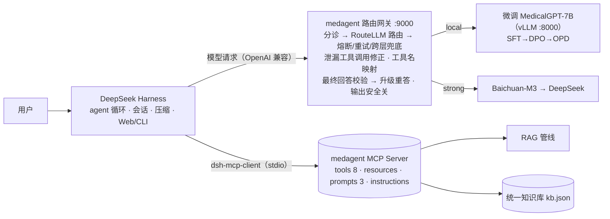

# 架构 v2：MCP 工具层 + RouteLLM 路由 + RAG + 容错层

本文回答四个设计问题：能不能用 DeepSeek Super-agent、工具层怎么改 MCP、路由分几档、容错层管哪些事。

## 1. 总览：DSH 是主运行时，微调 MedicalGPT 是本地模型



- **DSH 负责**：agent 循环（模型 ↔ 工具多轮）、会话持久化、上下文压缩、Web / headless / SDK 入口——这些不重复造。
- **路由网关负责**（`medagent/gateway.py`）：DSH 只认一个 OpenAI 兼容端点，所以路由、容错、校验都放在端点后面，对 DSH 透明。
  网关同时解决 MCP 化带来的一个兼容问题：DSH 给 MCP 工具加了 `mcp__medical__` 前缀，而微调模型训练时见到的是 `search_drug`，
  网关对模型去前缀、对 DSH 加回前缀，保住微调学到的工具调用能力（`tests/test_gateway.py` 覆盖）。
- **MCP Server 负责**：暴露工具、知识资源、提示词；执行被调用的那一个操作。
- **Python 编排器**（`medagent/agent.py`）：不依赖 DSH 的 headless 运行时，用于离线评测、CI 和混沌测试；
  Router–Worker、检查点、暂停/恢复都在这里验证。生产上以 DSH + 网关为准。

## 2. DeepSeek Super-agent：借鉴了什么、在本项目里具体怎么实现

DeepSeek 开源的 [dsh-superagent-prototype](https://github.com/deepseek-ai/dsh-superagent-prototype) 是建在 DSH 上的研究原型，
业务是“盯着 GitHub 仓库开工单、写代码、提 PR”，bundle 本身装不进医疗问答。借鉴的是它的 4 个设计，落点如下：

| 设计 | Super-agent 原型里 | 本项目里（代码位置） | 具体怎么做 |
|---|---|---|---|
| 轻量 Router 分派 | 常驻主 Session 用更小的工具集做分诊，只决定接不接、交给哪个 Worker | **DSH 模式**：`medagent/gateway.py` 的 `RoutingGateway.complete()`；**headless 模式**：`agent.py` 的 `_node_route` / `_node_plan` | Router 不生成答案，只做三件事：①安全分诊（规则 ∪ 分类器，毫秒级）②选回答档（`TieredRouter`：small / local / strong，MF 打分在 CPU 上算）③拆子问题（`QueryRewriter` 识别“先…再…”“药和饮食”）。决策写进检查点 `state["route"]`，可审计 |
| 上下文隔离的 Worker | 每个工单一个 Executor Session、独立目录，Worker 之间互不可见 | `agent.py` 的 `_node_work` → `_run_worker(s, wid, question)` | 每个子问题起一个 worker，`asyncio.gather` 并行。worker 的上下文只有：系统提示（从 MCP prompts 取）+ 患者关键槽位（年龄/孕期/过敏/在用药，`PatientProfile`）+ 它自己那一个子问题——看不到别的 worker 的对话与工具结果，也看不到完整历史（只有 w0 在有历史时拿压缩后的历史）。每个 worker 自己跑“模型 ↔ MCP 工具”循环，结果写回 `state["workers"][wid]`；合并默认确定性拼接，避免 LLM 合并时丢子答案 |
| 幂等 | Trigger 只存一次（stored / duplicate），外部副作用在事务提交后由 Outbox 执行 | 客户端 `mcp_client.py`（`run_idempotent`）+ 服务端 `medical_server.py`（`book_appointment` / `cancel_appointment`） | 有副作用的工具自动注入幂等键 = hash(run_id, worker, 轮次, 第几个调用, 规范化参数)，模型看不到也编不了；服务端按键去重，重放返回同一结果（`replayed: true`）。混沌测试：“服务端已执行、响应丢失”重试 20 次，重复挂号 1 → 0 |
| 中断后恢复 | 进程重启时中断的 Assignment 带恢复说明重跑，已汇报的保持 | `resilience/checkpoint.py` + `agent.py` 的 `_drive` / `resume` / `pause` | 每个节点（intake→route→plan→work→aggregate→verify→respond）结束写一次检查点；每个 worker 完成也单独落盘。暂停是协作式的：`pause()` 只把状态改成 pause_requested，运行中的流程在节点边界看到后保存并退出。`resume()` 从 `state["node"]` 继续，`status=done` 的 worker 不重跑；有副作用的步骤即使重放也被幂等键挡住。写检查点用版本号 CAS（乐观并发），另一个执行者已接管时本执行者必须停止，不会互相覆盖 |

**DSH 模式下怎么也用上 worker 隔离与逐步检查点**：DSH 自己的 agent 循环是单 agent 的，所以拆子问题和逐步检查点要由掌握循环的一方实现。
做法是把 Python 编排器做成**医疗工具 MCP Server 的第 8 个工具** `complex_consult`（`medagent/consult.py` 的 `ConsultRunner`），
和另外 7 个工具一样由模型决定调用、由 DSH 经 `mcp-medical` 实例执行：

```
用户：“先说说布洛芬的副作用，再说说高血压饮食注意什么”
DSH ──模型请求（带 8 个工具）──▶ 网关：路由器选档（安全规则 → MF → 小模型门控）
                                      多意图问题不会分给小模型（门控排除多意图，小模型档也不带工具）
    网关 ──▶ 百川 / 微调 MedicalGPT：判断要拆开查 → tool_call: complex_consult{question}
DSH ◀── 工具调用（网关原样交回，和其它工具一样）
DSH ──执行──▶ mcp-medical 实例 ──▶ 医疗工具 MCP Server：complex_consult
      编排器：intake → route → plan（拆 2 个子问题）→ work（w0、w1 并行，各自只拿子问题 + 患者槽位 + 5 个只读工具，
              连的是不含 complex_consult 的 Server，防递归）→ aggregate → verify → respond，每步落检查点
DSH ──带工具结果再请求──▶ 网关：结果 status=done → 直接把编排器的回答交给用户（只过输出安全关），不再让模型转述
```

- **由模型决定调用**：多意图问题和其它问题一样先选档，再由被选中的模型决定。dev 集 6 道多要点题全部被路由到 strong（百川）。
  微调 MedicalGPT 训练时没见过这个工具，所以补了训练数据（`consult_samples.py`：多意图 → 调用 400 条 / 单一问题 → 调普通工具 400 条，
  工具清单就是 MCP Server 列出的 8 个）；模型没有调用而漏答子问题时，校验器的 incomplete_multi 会拦下并升级 strong 重答。
- **演变**：2026-11-09 第一版是单独的 MCP Server（多一个 DSH 插件实例），由网关按规则返回工具调用；2026-11-10 先并入网关进程，
  随后按需求改为现在的做法——作为同一个 MCP Server 的第 8 个工具，DSH 里仍只有一个 `mcp-medical` 实例。
- **中断续跑**：run_id = hash(问题 + 历史)。同一进程里出错自动从检查点再续跑一次；仍失败时返回错误，模型可以用相同参数重试（命中同一检查点）
  或改用普通工具。人为暂停（`medagent pause <run_id> --consult`）的问诊不自动续跑。进度可读资源 `consult://run/{run_id}`。
- **超时**：`mcp-medical` 实例的工具超时提到 180 秒（复杂问诊要跑几十秒）；其它 7 个工具内部各有 15 秒超时。
- **模型 key**：编排器在 MCP Server 进程里直接调模型，Server 进程需要与网关相同的模型 key（DSH 继承启动它的 shell 环境变量）。
- **好处**：DSH 的会话记录里能看到 complex_consult 这一步工具调用和它的结果；编排器内部各 worker 的工具调用记在检查点里。
- 评测：`evaluation/run_consult_eval.py`，结果在 `evaluation/results/consult_eval.json`。

## 3. MCP：Server 提供什么、谁在调度

**MCP Server 不调度。** 在 MCP 里，Server 只声明自己有哪些能力并执行被请求的那一个操作；决定“用哪个工具、什么时候用、
失败了怎么办”的是宿主（Host，这里是 DSH 或 Python 编排器）。所以“MCP 服务器调度工具”这个说法不准确：调度在宿主，
Server 是能力提供方。

**只提供工具也是合法的 MCP Server**（工具只是 MCP 三类服务端能力之一，现实中很多 MCP Server 只有工具）。但本项目的知识
天然适合做成资源，提示词也需要一个唯一来源，所以 v2 三类都用上了：

| MCP 能力 | 本项目提供的内容 | 谁来用 | DSH 支持情况 |
|---|---|---|---|
| tools（模型决定调用） | check_symptom、search_drug（含商品名、类别、症状反查）、check_interaction、search_guideline、search_knowledge（RAG）、book_appointment、cancel_appointment、complex_consult（复杂问诊，运行编排器） | 模型 | ✓ |
| resources（宿主按 URI 读数据） | kb://catalog、kb://version、kb://provenance、kb://drug/{name}、kb://symptom/{name}、kb://guideline/{topic}、kb://sources（各知识源规模与状态）、kb://doc/{id}（检索命中文档全文）、consult://run/{run_id}（复杂问诊检查点） | 编排器：确定性兜底（模型全挂时读条目）；宿主：审核界面、查看问诊进度 | ✓（经 mcp-resources 共享工具） |
| prompts（服务端维护的模板） | medical_system_prompt、triage_clarify、answer_with_evidence | Python 编排器（系统提示词从这里取，唯一来源） | ✗（DSH 的 MCP 客户端不支持 prompts，DSH 侧用 instructions + persona） |
| instructions | 工具使用规则（先查后答、查不到不编、有副作用要幂等键） | 宿主注入系统提示 | ✓ |

“查”和“读”的分工：本地全文索引（329 万篇）和在线文献（PubMed / Europe PMC）是按问题检索的，要模型决定查什么，
所以走工具 `search_knowledge`；检索命中某一篇后按 ID 取全文是资源 `kb://doc/{id}`。在线文献存在对方服务器上，只能实时检索，不做成资源。
模型全挂时，网关（DSH 模式）的降级回答是在进程内直接读 `kb.json`，Python 编排器则通过 `kb://` 资源读，两条路读的是同一份数据。

工程约定：
- 工具带 MCP annotations（只读 / 幂等 / 有副作用），客户端据此自动给有副作用的工具注入幂等键，模型看不到也编不了这个参数；
- 工具失败统一抛 `ToolError("<KIND>: ...")`，客户端据前缀精确归因（参数错 / 外部依赖错 / 冲突）；
- 原来的 `index.ts`（`ctx.tools.register` 往 DSH tool registry 注册）已删除；迁移时曾漏掉它的“症状反查药品”行为，已补回（问题 N39）。

## 3.1 知识库是怎么来的

见 `medagent/knowledge/build_kb.py` 文件头。要点：
- 原仓库同一套知识表有两份：运行时 `index.ts`（症状 10 / 药 5 / 指南 4）与造数脚本 `build_toolcall_data.py`（20 / 10 / 9）。
  模型用后者生成的轨迹训练，上线后却查前者——训练与服务不一致，“嗓子疼”这类在训练中见过的条目线上查不到。
- 两份原表冻结为 `medagent/knowledge/sources/*.json`，由 `build_kb.py` 合并（A ∪ B，冲突以训练用的 B 为准），
  结果 21 / 10 / 9，唯一冲突“头晕”记录在 `evaluation/results/kb_unification.json`。
- **来源局限**：两份表都是原作者手写的规则表，不是从药典、说明书或指南原文导入的；所有条目 `reviewed=false`。
  RAG 的大语料部分来自 `raw_medical_qa.jsonl`（原项目从 shibing624/medical、Huatuo26M-Lite、sharegpt_zh_38K 抽样）。
  上线前应由医生 / 药师审核，或换成权威来源（`docs/rag_sources.md`）。

## 4. 路由：三档回答模型（small / local / strong）

| 档 | 模型 | 角色 | 进入条件 |
|---|---|---|---|
| strong | Baichuan-M3 → DeepSeek（云端） | 强模型 | 急症/危机、高风险意图（开药/诊断/手术），或 RouteLLM-MF 判定本地模型可能答砸（P ≥ 阈值） |
| local | 微调 MedicalGPT-7B（vLLM） | 弱模型（RouteLLM 意义上的 weak），默认档 + 兜底 | 其余问题；工具调用、药品、症状都在这一档 |
| small | Qwen3.5-2B（可换 0.8B） | 简单问答 | 只有通过门控的问题：概念/科普题（“什么是 BMI”），不涉及具体个人、不涉及药名与用药决策、单一意图、无历史 |

实现：`medagent/router/policy.py` 的 `TieredRouter`，相当于 RouteLLM 的两个二分类路由器级联——先用 MF 打分决定要不要上 strong，
不上 strong 的再用门控决定能不能降到 small。安全规则永远优先。小模型档的保护：
- 不给工具（概念题不需要，也避免小模型乱调工具）；
- 回答同样过校验器，被拦截先升到 local（带工具），local 再不行升 strong（网关 `escalate_local` → `regenerate_strong`）；
- 一旦本轮进入工具循环，后续请求不会再回落到 small。
实测见 `evaluation/results/small_tier_eval.json`（Qwen3.5-2B 在 80 条真实问题上的回答与 MedicalGPT 对比）。

**MF 的训练与评测分离（2026-11-10）**：原来的 MF 用 dev 80 条训练，又在这 80 条上看路由效果，是样本内成绩；
阈值也是在这 80 条上按 40% 定的。拿 2,000 条独立的真实问诊提问一测，交给强模型的比例是 82%（dev 80 上是 49%）。现在：
- `evaluation/router/build_router_set.py`：2,000 条真实提问，与训练数据、所有评测集不重叠，集合内部近重复也去掉，切 train / val / test；
- `label_router_set.py`：本地模型逐题作答，修复前被校验器拦下、或裁判（百川）对照参考答案判为 unsafe / poor，记为答砸；
- `train_router.py`：train 训练、val 早停并定阈值、test 与 dev 80 报告；不到 30 条答砸样本拒绝训练；
- `calibrate_router.py`：没有标签时，也能在真实提问 val 上按总体预算（含安全规则强制交给强模型的 33%）重定阈值——
  冷启动 MF 已经这样重新校准过，test 上交给强模型 39.9%；
- 运行时优先加载 `mf_router.npz`（独立数据训练），没有时才用冷启动版并告警；`/healthz` 显示当前用的是哪个。

RouteLLM 的接法：`medagent/router/mf_router.py` 与官方 `routellm/routers/matrix_factorization/model.py` 同构
（`σ(s(strong,q) − s(weak,q))`，`s = wᵀ(normalize(P_m) ⊙ W e_q)`），e_q 换成本地特征、用本项目自己的偏好标签训练——
官方权重来自 Chatbot Arena 的 GPT-4/Mixtral 对、推理时还要调 OpenAI embedding，不适用于中文医疗。

### 为什么本地模型是 Qwen2.5-7B 而不是 Qwen3.5

Qwen3.5 在 2026-02 已发布（小尺寸 0.8B / 2B / 4B / 9B / 27B 稠密 + 35B-A3B 等 MoE），原项目 2026-09 训练时选了 Qwen2.5-7B，
从仓库能看出的约束：
- **推理栈**：部署日志里 vLLM 被降到 0.8.x（新版 vLLM 拉 CPU 版 torch）；Qwen3.5 需要 vLLM 0.17+，工具解析器也从 `hermes` 换成 `qwen3_coder`，还要配 reasoning parser；
- **训练栈**：MedicalGPT 的模板与工具格式（`--template_name qwen --tool_format default`）是按 Qwen2.5 对话格式写的；Qwen3.5 是多模态架构（`Qwen3_5ForConditionalGeneration`）、带思考模式，LoRA 目标层与模板都要重新适配；
- **显存**：AutoDL 单卡 24GB。Qwen3.5-9B bf16 权重约 19GB，LoRA 训练要上 QLoRA；OPD 阶段还要同时放 32B 教师；
- 同行做法：百川 M2 的报告也说明 SFT 基座选 Qwen2.5 而不是 Qwen3 是出于训练稳定性。
重训方案见 [train_qwen35_plan.md](train_qwen35_plan.md)（Qwen3.5-9B + QLoRA，训练 / 推理格式逐字对齐）。
建议：v3 数据就绪后用 Qwen3.5-9B（或 4B）做一次对照训练，在同一套 dev / 独立测试集上比，再决定是否换基座——
“更新”不等于“在你的数据和任务上更好”，要用评测说话。

强模型候选（以各平台控制台的模型 ID 为准）：Baichuan-M3（[模型卡](https://huggingface.co/baichuan-inc/Baichuan-M3-235B) 自报 HealthBench 领先，厂商自报）、
DeepSeek；可替换为开源的蚂蚁 [AntAngelMed](https://github.com/MedAIBase/AntAngelMed)、京东 JoyMed。

## 5. RAG

| 环节 | 实现 | 评测结论（`evaluation/results/rag_eval_*.json`） |
|---|---|---|
| 查询改写 | 去口语噪声、口语/商品名→标准术语“追加式”扩展、复合问题拆子查询；可选小模型改写 | KB 集 Recall@5 0.856→0.956 |
| 多路召回 | BM25（jieba 词 + 字二元组）、向量（bge-small-zh）、KG 实体链接直达 KB、在线源（openFDA / PubMed / MedlinePlus，各自熔断） | 三路 RRF 让真实问答集 Recall@5 0.48→0.60 |
| 混合检索 | RRF（只用名次，免去分数量纲对齐） | — |
| 重排 | 交叉编码器 bge-reranker-base（可换 Qwen3-Reranker-0.6B）；KG 命中置顶 | QA Recall@5 0.60→0.67；词法重排是负收益，已弃用 |
| 压缩 | 抽取式句子选择 + 跨文档去近重复，按 token 预算，保留出处（不用生成式摘要，避免改写出错） | 证据 token −50%，金标文档保留 100% |
| 缓存 | 精确（规范化查询）+ 语义（向量 ≥0.95）；键带 kb_version；Redis / 进程内 | 命中 0.01ms vs 未命中 ~350ms |

开源知识源的选择见 `docs/rag_sources.md`。

## 6. 容错层

| 机制 | 位置 | 要点 |
|---|---|---|
| 错误归因 | `resilience/errors.py`、`verify/attribution.py` | 网络/超时/限流/鉴权/参数/模型/静默/外部/策略/熔断/冲突；PARAM 进一步区分“模型生成的参数错”还是“代码拼的参数错” |
| 分类重试 | `resilience/retry.py` | 只重试“换个时间可能成功”的错误；限流遵守 Retry-After；全局重试预算防风暴 |
| 熔断 | `resilience/breaker.py` | 滑窗失败率；状态存 Redis（Lua 原子更新、NX 探针锁），多实例共享；Redis 不可用自动降级为本地并对 Redis 本身短路 |
| 降级 | `llm/pool.py`、`templates.py` | 同层换 provider → 跨层 → 确定性工具查询 + 模板回答 |
| 幂等 | `resilience/idempotency.py` + MCP Server | 客户端与服务端双层；“服务端已执行但响应丢失”重试也不会重复挂号 |
| 补偿 | `resilience/saga.py` | 多步副作用逆序补偿；补偿失败进死信并留痕 |
| 暂停 / 恢复 | `resilience/checkpoint.py` + `agent.py` | 节点边界协作式暂停；崩溃后 resume 不重跑已完成的 worker |
| 乐观并发 | `checkpoint.py` | version CAS；暂停请求、同会话并发消息、多执行者接管都不会互相覆盖 |
| 静默失败校验 | `verify/` | 规则阻断（来自真实失败样本）→ 本机开源判别模型（类型化输出：等级 + 概率） |

### 结果校验：开源判别模型（替代 Jev）
早期方案接 Jev（TypeSafe AI 的判别模型，外部 API，早期访问），一直没有接入地址，实际只用规则。现在换成自己微调的开源小模型：
Qwen3.5-2B + LoRA，本机 vLLM 部署（:8002），输入程序状态（问题、回答、工具结果证据、规则结论、急症 / 高风险标记），只输出一个字母
A / B / C / D（质量等级），用首 token 概率得到等级分布，P(静默失败) = P(C) + P(D)。一次请求同时给出校验和质量两个判定，不调外部 API。
级联位置不变：规则（确定性、几乎零误报）→ 判别模型（p ≥ block_at 升级重答，中间带进人工复核）；没部署时只用规则。
训练数据以基座模型在路由数据集 train / val 上的真实回答为主，标签来自百川裁判，再加规则抓不到的语义故障注入；
上一轮用合成故障训练的 TF-IDF 分类器迁移不到真实失败（AUROC 0.56），这次改成真实回答为主。细节见 [verifier_model.md](verifier_model.md)。

## 7. 上下文压缩

`medagent/context.py`：临床关键槽位（年龄、性别、孕期、过敏、在用药、慢病、既往危险信号）从全部历史抽取后常驻、永不压缩；
最近 K 轮原文；更早轮次由控制面小模型做保事实摘要，小模型不可用时退回抽取式；切分点不会把 tool_call 与其结果拆开。
